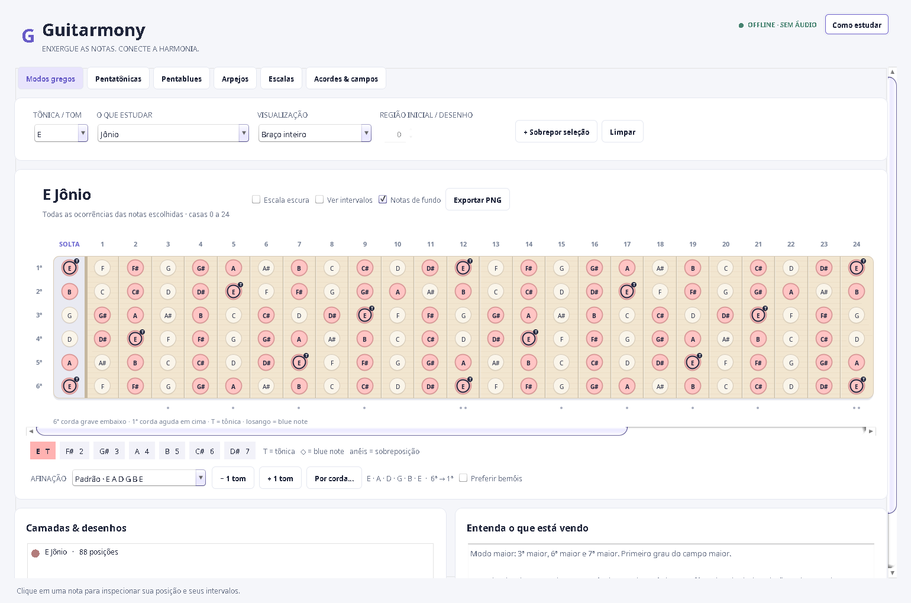

# Guitarmony

Aplicativo de estudo visual de harmonia para guitarra. Java 17+, interface Swing,
seis cordas e 24 casas. Funciona offline, sem áudio e sem bibliotecas externas em
tempo de execução.



## Executar no IntelliJ IDEA

1. Extraia o ZIP e abra a pasta `Guitarmony` ou seu `pom.xml` no IntelliJ.
2. Em **File → Project Structure → Project SDK**, escolha um **JDK 17 ou superior**.
   Se necessário, use **Download JDK** do próprio IntelliJ.
3. Abra `src/main/java/com/guitarmony/GuitarmonyApp.java` e execute `main()` pelo
   botão verde ao lado da classe.

O Maven facilita a importação no IntelliJ, mas não é necessário para compilar ou
executar. A aplicação precisa de uma sessão gráfica no Windows, macOS ou Linux;
um servidor Linux sem display não consegue abrir uma janela.

## Executar o JAR entregue

Com Java 17 ou superior instalado:

```sh
java -jar dist/Guitarmony.jar
```

No Windows, `run.bat` também abre o aplicativo. No macOS/Linux, use `./run.sh`
ou `bash run.sh`. Esses atalhos fazem o build caso o JAR ainda não exista.
O Java pode não estar associado a arquivos `.jar` por duplo clique; o comando
acima independe dessa associação.

## Compilar e testar sem Maven

Com o JDK 17 ou superior no `PATH`:

```sh
# macOS / Linux
./build.sh
./test.sh
./run.sh
```

```bat
rem Windows, no Prompt de Comando
build.bat
test.bat
run.bat
```

O resultado é `dist/Guitarmony.jar`. Os testes não precisam de uma interface
gráfica, não dependem de JUnit e encerram com erro se qualquer verificação
falhar. A suíte verifica fórmulas, grafia musical, campos harmônicos, afinações,
mapas de notas, desenhos modais, boxes pentatônicos e voicings. Uma segunda
suíte aciona os controles reais da interface: troca de tom, desenhos, camadas,
limpeza, afinação, abas, acordes, voicings e progressões. Os testes imprimem o
número de grupos e de verificações realmente executados em cada suíte.

Opcionalmente, com Maven instalado, `mvn test` executa as mesmas suítes na fase de
testes e `mvn package` gera o JAR em `dist`. Na primeira execução, o Maven precisa
baixar seus plugins de compilação e execução. Os scripts diretos usam somente
as ferramentas do JDK e dispensam esses downloads.

## Como estudar

O botão **Como estudar**, no cabeçalho do aplicativo, abre a ajuda durante o uso.

- Escolha a família, a fórmula e a tônica. As mudanças atualizam o braço
  imediatamente. Trocar a tônica ou fórmula substitui o estudo ativo.
- **Braço inteiro:** mostra todas as ocorrências das notas da fórmula entre a
  corda solta e a casa 24. Não representa um único desenho de digitação.
- **Um desenho:** isola uma posição. Modos usam três notas por corda;
  pentatônicas, duas. Ajuste a casa de referência para deslocar a posição.
- **Sequência:** mostra os desenhos ao longo do braço com cores diferentes.
  Nos modos, mantém o mesmo campo de notas: **E Jônio → F# Dórico → G# Frígio →
  A Lídio → B Mixolídio → C# Eólio → D# Lócrio**. Isso é diferente de sobrepor
  sete modos independentes com a mesma tônica.
- Use a ação explícita de sobreposição para comparar estudos independentes.
  Células compartilhadas mostram as cores das camadas sem apagar o nome da nota.
- A aba de acordes permite escolher o campo e um grau, visualizar suas notas e
  explorar voicings. Um voicing mostra uma única casa por corda; `x` significa
  corda abafada e `0`, corda solta. Um mapa de arpejo mostra posições possíveis
  das notas e não significa que todas devam ser tocadas simultaneamente.
- **Limpar** remove as marcações e comparações. A visualização clara/escura,
  nomes ou intervalos, visibilidade das notas de fundo e exportação em PNG
  ajudam a adaptar o estudo.

O braço mantém a orientação do material: **Mi agudo em cima e Mi grave embaixo**.
A afinação é descrita da corda grave para a aguda: **E A D G B E**. O botão
global de **+1 tom / −1 tom** transpõe a afinação em **dois semitons**; ajustes
individuais das cordas permitem afinações alternativas. A afinação muda as
posições físicas das notas; a fórmula e a tônica do estudo permanecem escolhidas.

## Conteúdo e convenções musicais

- Sete modos gregos; escalas maior, menor natural, menor harmônica e menor
  melódica ascendente/jazz.
- Pentatônicas maior, menor, menor 6, dominante e menor com quinta diminuta.
- Pentablues maior, menor, dominante e variante meio-diminuta.
- Arpejos de tríades e tétrades maiores, menores, dominantes, diminutas,
  meio-diminutas, aumentadas, suspensas e algumas extensões de 9ª, 11ª e 13ª.
- Campos harmônicos calculados pelo empilhamento de terças, em tríades ou
  tétrades, para a escala de sete notas escolhida.

`T` identifica a tônica; `b` e `#` alteram o grau. `maj7` é sétima maior, `7`
é sétima menor em um acorde dominante, `m7` é menor com sétima menor e
`m7(b5)` é meio-diminuto. A pentablues maior acrescenta **b3** à pentatônica
maior; a menor acrescenta **#4/b5** à pentatônica menor. A menor melódica
clássica descendente corresponde à menor natural, disponível separadamente.

As notas respeitam a grafia dos graus: F# maior contém **E#**, e C# maior contém
**B#**. Notas enarmônicas ocupam a mesma casa, mas podem ter nomes diferentes
conforme sua função. Extensões como 9, 11 e 13 são exibidas nas mesmas classes
de altura de 2, 4 e 6; o braço não impõe uma oitava específica ao arpejo.

Os desenhos são calculados a partir dos intervalos, da afinação e dos padrões
de três/duas notas por corda. Os boxes de blues mantêm a base pentatônica e
incluem a blue note próxima a cada desenho. Na região da pestana e após a
casa 24, notas teóricas fora do braço são recortadas.
Quando um box escolhido começaria após a casa 24, o mesmo desenho volta uma
oitava e recebe o aviso **oitava anterior**, sem ser substituído por outro box.
Os resultados seguem a lógica do material, mas não são uma transcrição exata de todas as digitações
manuscritas das fotos. Voicings são sugestões matemáticas com notas completas
e abertura de até quatro casas; a ergonomia individual ainda deve ser avaliada.

## Organização e desempenho

`music` contém fórmulas imutáveis, afinação, nomes, harmonia e busca de voicings;
`fretboard`, as posições e desenhos; `ui`, a interação e o desenho vetorial.
A interface usa a thread de eventos do Swing. O braço tem apenas 150 células,
e suas notas são recalculadas quando a seleção muda. A busca de acordes é
limitada e reutiliza resultados com um pequeno cache FIFO. Não há reprodução
de áudio, servidor, banco de dados, telemetria ou chamadas de rede na aplicação.

FIFO é usado onde limita memória de resultados; Bubble Sort não foi aplicado
porque não melhora este fluxo. Os arquivos gerados ficam em `build`, `dist` e,
caso seja usado Maven, `target`.
